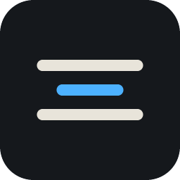

<div align="center">



# Rigo ✍️

**Un editor Markdown local-first per scrivere senza distrazioni.**

[](https://github.com/massigent/rigo/actions/workflows/ci.yml)
[](https://github.com/massigent/rigo/releases)
[](LICENSE)
[](#scarica)

Scorrimento a macchina da scrivere · Focus su frase · Anteprima live · File normali sul disco

[**Scarica**](#scarica) · [Funzionalità](#funzionalità) · [English](README.md)

</div>

---

## Che cos'è Rigo, e a cosa serve?

Rigo è un **editor senza distrazioni per Markdown**, il formato plain-text del web. Un unico
eseguibile avvia sul tuo computer un ambiente di scrittura: lo scorrimento a macchina da
scrivere tiene al centro dello schermo la riga che stai scrivendo, la modalità focus attenua
tutto tranne la frase o il paragrafo corrente, e l'anteprima si aggiorna mentre digiti. Quando
chiudi, il tuo lavoro è già salvato — in normali file `.md` che puoi aprire con qualsiasi altro
strumento.

Niente account, niente cloud, niente telemetria, niente database, niente lock-in. **I tuoi
documenti non lasciano mai la macchina: local-first per architettura, non per promessa.**

### A chi è utile?

- **A chi scrive** e butta giù bozze in testo semplice, e vuole che l'interfaccia scompaia mentre compone.
- **A sviluppatori e technical writer** che vivono tra Markdown, blocchi di codice e cartelle locali.
- **A studenti e chi prende appunti** e vuole note veloci in un formato che si aprirà ancora tra vent'anni.
- **A chi preferisce i file ai servizi** e apprezza uno strumento che funziona offline, per sempre.

### In sintesi

| | |
| :--- | :--- |
| **Formato** | File Markdown nelle loro cartelle — niente importazioni, niente esportazioni |
| **Runtime** | Un unico eseguibile Go (~6 MB); l'interfaccia gira nel browser, senza Electron e senza Node.js |
| **Sicurezza dei dati** | Salvataggi atomici, rilevamento delle modifiche esterne, avvisi sui conflitti, protezione dei file in sola lettura, «Salva con nome» che copia |
| **Font** | IBM Plex Mono/Sans/Serif, EB Garamond, Lora — tutti SIL OFL, incorporati nel binario, nessuna richiesta di rete |
| **Lingue** | Interfaccia in italiano; documenti in qualsiasi lingua |

> [!NOTE]
> Rigo si chiamava TypeCraft. Il cambio nome è arrivato con la pulizia delle licenze: i font
> incorporati sono ora IBM Plex (SIL OFL) e il progetto è pubblicato con licenza MIT. Per i tuoi
> documenti non cambia nulla: stessi file Markdown, stesse cartelle, e recenti e preferenze
> migrano automaticamente al primo avvio.

## Scarica

I pacchetti precompilati per **Linux, Windows e macOS** sono nella
[pagina dei rilasci](https://github.com/massigent/rigo/releases/latest) (attualmente v1.1.1), con
`SHA256SUMS` per la verifica:

| Sistema | Pacchetto | Installazione |
| :--- | :--- | :--- |
| Ubuntu/Debian | `rigo_*_amd64.deb` | `sudo apt install ./rigo_1.1.1-1_amd64.deb` |
| Fedora/RHEL | `rigo-*.x86_64.rpm` | `sudo dnf install ./rigo-1.1.1-1.x86_64.rpm` |
| Qualsiasi Linux | `Rigo-x86_64.AppImage` | `chmod +x` e via (nessuna installazione; `APPIMAGE_EXTRACT_AND_RUN=1` senza FUSE) |
| Windows x64 | `Rigo-*-windows-x64-setup.exe` | Esegui l'installatore dal tuo account |
| macOS (Apple Silicon / Intel) | `Rigo-*-macos-*.zip` | Estrai, sposta `Rigo.app` in Applicazioni |

I build per Windows e macOS non sono firmati o notarizzati: il sistema chiederà conferma al
primo avvio.

## Funzionalità

### Scrittura senza distrazioni
- **Scorrimento a macchina da scrivere** — la riga attiva resta fissa al centro dello schermo; il
  testo scorre sotto le tue dita con tracciamento sub-pixel del cursore.
- **Modalità focus** (`Ctrl+D`) — isola la frase o il paragrafo corrente; il testo circostante
  svanisce delicatamente (opacità 30%).
- **Interfaccia Zen** — mentre digiti barre e contatori scompaiono del tutto; muovi il mouse o
  premi `Esc` per riaverli.
- **Suono meccanico** (`Ctrl+Alt+T`) — ticchettio e campanella di ritorno carrello sintetizzati
  via Web Audio API, generati in codice (zero file audio).
- **Tipografia d'autore** — IBM Plex Mono/Sans/Serif più i serif editoriali EB Garamond e Lora,
  incorporati nel binario: nessun font di sistema, nessuna richiesta di rete.

### Markdown e anteprima
- **Tre viste** — sorgente (`Ctrl+1`), anteprima live (`Ctrl+2`), vista divisa sincronizzata (`Ctrl+3`).
- **Task list interattive** — i checkbox si cliccano direttamente a schermo e aggiornano il
  sorgente Markdown all'istante, attraverso l'albero dei token del parser (elenchi puntati,
  numerati, annidati, citati e duplicati compresi).
- **Tabelle formattate** — bordi arrotondati e righe zebrate; **blocchi di codice** con tag del
  linguaggio e pulsante di copia.
- **Immagini locali** — `` è risolto rispetto alla cartella del documento e
  servito dall'app: niente immagini rotte, niente percorsi da indovinare.
- **Formule matematiche** — il TeX inline `$E=mc^2$` e in blocco `$$…$$` è protetto dal parsing
  Markdown e mostrato come sorgente TeX formattato (KaTeX è in roadmap).
- **Indice dinamico** (`Ctrl+Shift+O`) — indice del documento in tempo reale, con salto diretto
  alle sezioni.

### Uso locale e sicurezza dei dati
- **Un eseguibile** — un binario Go serve l'interfaccia nel tuo browser; non serve installare
  altro, e funziona completamente offline.
- **Avvio desktop** — apre una finestra autonoma del browser quando lo supporta.
- **I salvataggi sono atomici** e preservano i permessi dei file: l'editor non lascia mai un
  file scritto a metà.
- **Watchdog delle modifiche esterne** — un buffer pulito si ricarica dal disco, uno modificato
  avverte (`⚠️ Modificato su disco`) e nemmeno una riga digitata viene toccata. I conflitti sono
  rilevati con impronte di contenuto (`sha256`), non con i timestamp: una modifica esterna è
  individuata anche a dimensione e orario identici.
- **I file in sola lettura sono protetti dal backend**, non solo dall'interfaccia: un file senza
  permessi di scrittura non può essere salvato, rinominato né sovrascritto, nemmeno con un
  override esplicito del conflitto. Un documento protetto offre **Salva una copia**, che scrive
  un nuovo file e non tocca mai l'originale.
- **«Salva con nome» scrive una copia**; rinominare/spostare è un'azione separata ed esplicita,
  e il backend rifiuta destinazioni che sono alias della sorgente (symlink, hard link).
- **Istanza singola** — avviare una seconda copia (o un file dal file manager) inoltra alla
  prima tramite un canale autenticato e vi apre il file.

## 🎨 Quattro temi d'autore

1. **☀️ Carta** — carta bianca netta, inchiostro grigio scuro, cursore blu elettrico.
2. **📜 Sepia** — tono caldo e calmo per lunghe sessioni di lettura e scrittura.
3. **🌙 Notte** — ardesia scura per gli ambienti con poca luce.
4. **⬛ OLED** — nero vero `#000000` con accenti luminosi.

## ⌨️ Scorciatoie da tastiera

| Scorciatoia | Azione |
| :--- | :--- |
| `Ctrl/Cmd + S` | Salva subito (il salvataggio automatico è attivo di default) |
| `Ctrl/Cmd + Shift + S` | Salva con nome (scrive una copia) |
| `Ctrl/Cmd + O` | Apri un file Markdown |
| `Ctrl/Cmd + N` | Nuovo documento |
| `Ctrl/Cmd + P` | Stampa / salva come PDF (sempre renderizzato) |
| `Ctrl/Cmd + D` | Cicla il focus: spento → frase → paragrafo |
| `Ctrl/Cmd + T` | Attiva/disattiva lo scorrimento a macchina da scrivere |
| `Ctrl + Alt + T` | Attiva/disattiva il suono meccanico |
| `Ctrl + Shift + O` | Attiva/disattiva l'indice |
| `Ctrl + 1` / `Ctrl + 2` / `Ctrl + 3` | Sorgente · anteprima · vista divisa |
| `Ctrl/Cmd + B` / `+ I` / `+ K` | Grassetto · corsivo · link |
| `F11` | Modalità zen a schermo intero |
| `Esc` | Chiudi i pannelli / riattiva l'interfaccia |

## 🛠️ Compilazione e uso

```bash
# Compila per la macchina corrente
make build && ./rigo        # oppure semplicemente: go build .

# Cross-compila per Linux (amd64/arm64), macOS (amd64/arm64) e Windows (amd64)
make cross-compile          # i binari finiscono in dist/

# Pacchetti nativi (Linux)
make linux-packages         # deb + rpm + AppImage in dist/

# Installatore Windows e app macOS
make windows-installer      # richiede NSIS e icotool
make macos-packages         # richiede png2icns e python3
```

Strumenti necessari per il packaging: `dpkg-deb`, `rpmbuild`, `appimagetool` (non pacchettizzato
in Debian: scarica l'AppImage ufficiale e lancialo con `APPIMAGE_EXTRACT_AND_RUN=1`),
`makensis`, `icotool`, `png2icns`. Ogni pacchetto incorpora `packaging/copyright`, l'avviso
completo delle componenti terze. La build è collaudata da `tests/packaging-smoke.sh` e
`tests/desktop-packaging-smoke.sh`.

Un **prototipo nativo in Rust** dell'editor (egui, senza browser) vive sul branch
[`rust-native`](https://github.com/massigent/rigo/tree/rust-native).

## 📜 Storia dei rilasci

| Versione | Focus |
| :--- | :--- |
| [1.1.1](docs/releases/v1.1.1.md) | **Gli aggiornamenti conservano le preferenze**: il profilo del browser — tema, font, vista, typewriter, focus, suono — viene portato dal vecchio nome invece di essere ricreato. |
| [1.1.0](docs/releases/v1.1.0.md) | **Il cambio nome in Rigo**: rilascio MIT, font IBM Plex (SIL OFL), logo originale generato, nomi dei temi neutrali — le preferenze migrano automaticamente. |
| [1.0.6](docs/releases/v1.0.6.md) | Prestazioni: avvio e percorsi caldi per battuta sui documenti grandi. |
| [1.0.5](docs/releases/v1.0.5.md) | Selezione della parola col doppio clic a scorrimento attivo. |
| [1.0.4](docs/releases/v1.0.4.md) | Hardening di sicurezza: nessun token sulla riga di comando del browser, corpi limitati, CI. |
| [1.0.3](docs/releases/v1.0.3.md) | Correttezza: blocchi di codice, buffer senza titolo, revisioni a impronta di contenuto, protezione in sola lettura, revisione in [`REVIEW-1.0.3.md`](REVIEW-1.0.3.md). |
| [1.0.2](REVIEW-1.0.2.md) | Prima passata di revisione pubblica: anteprima sanificata, inoltro a istanza singola, precisione delle task list. |

## 🗺️ Roadmap

- Includere KaTeX per l'impaginazione reale delle formule (e Mermaid per i diagrammi).
- Trova e sostituisci (con regex) e un obiettivo di conteggio parole.
- Un passaggio lessicale su cliché e riempitivi per la prosa.
- Editing delle tabelle, drag & drop delle immagini, barra laterale con fissaggi e filtri `#tag`.
- Export in PDF/DOCX via Pandoc.

## 📄 Licenza

Rigo è rilasciato con la [licenza MIT](LICENSE). Le componenti terze incorporate (font, il parser
Markdown, la libreria standard di Go) mantengono le proprie licenze, elencate con i testi
integrali in [THIRD-PARTY.md](THIRD-PARTY.md); lo stesso avviso è dentro ogni pacchetto.

Rigo non è affiliato ad alcun altro editor. I nomi di altri prodotti compaiono solo nei documenti
di revisione storici (`REVIEW-*.md`).

Creato con mestiere per chi scrive e per chi programma.
