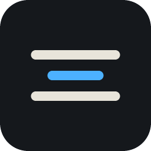

<div align="center">



# Rigo ✍️

**A local-first Markdown editor for focused writing.**

[](https://github.com/massigent/rigo/actions/workflows/ci.yml)
[](https://github.com/massigent/rigo/releases)
[](LICENSE)
[](#download)

Typewriter scrolling · Sentence focus · Live preview · Plain files on disk

[**Download**](#download) · [Features](#features) · [Italiano](README.it.md)

</div>

---

## What is Rigo, and what is it for?

Rigo is a **distraction-free editor for Markdown**, the plain-text format of the web. One small
executable starts a writing environment on your own machine: typewriter scrolling keeps the line
you are writing at the centre of the screen, focus mode dims everything except the current
sentence or paragraph, and a live preview renders as you type. When you are done, your work is
already saved — as ordinary `.md` files you can open with any other tool.

No account, no cloud, no telemetry, no database, no lock-in. **Your documents never leave the
machine: local-first by architecture, not by promise.**

### Who is it for?

- **Writers** who draft in plain text and want the interface to disappear while they compose.
- **Developers and technical writers** who live in Markdown, code blocks and local folders.
- **Students and note-takers** who want fast notes in a format that will still open in twenty years.
- **Anyone who prefers files over services** and values a tool that works offline, forever.

### At a glance

| | |
| :--- | :--- |
| **Format** | Plain Markdown files in their own folders — nothing imported, nothing exported |
| **Runtime** | A single Go executable (~6 MB); the interface runs in your browser, no Electron, no Node.js |
| **Data safety** | Atomic saves, external-change detection, conflict warnings, read-only protection, copy-style “Save as” |
| **Fonts** | IBM Plex Mono/Sans/Serif, EB Garamond, Lora — all SIL OFL, embedded in the binary, no network requests |
| **Languages** | Interface in Italian; documents in any language |

> [!NOTE]
> Rigo was previously called TypeCraft. The rename came with a licensing cleanup: the bundled
> fonts are now IBM Plex (SIL OFL) and the project is published under the MIT license. Nothing
> changes for your documents: the same Markdown files, the same folders, and your recents and
> preferences are migrated automatically on first start.

## Download

Prebuilt packages for **Linux, Windows and macOS** are on the
[releases page](https://github.com/massigent/rigo/releases/latest) (v1.1.1 currently), with
`SHA256SUMS` for verification:

| System | Package | Install |
| :--- | :--- | :--- |
| Ubuntu/Debian | `rigo_*_amd64.deb` | `sudo apt install ./rigo_1.1.1-1_amd64.deb` |
| Fedora/RHEL | `rigo-*.x86_64.rpm` | `sudo dnf install ./rigo-1.1.1-1.x86_64.rpm` |
| Any Linux | `Rigo-x86_64.AppImage` | `chmod +x` and run (no installation; `APPIMAGE_EXTRACT_AND_RUN=1` without FUSE) |
| Windows x64 | `Rigo-*-windows-x64-setup.exe` | Run the setup from your account |
| macOS (Apple Silicon / Intel) | `Rigo-*-macos-*.zip` | Extract, move `Rigo.app` to Applications |

Windows and macOS builds are not signed or notarized; your OS will ask you to confirm the first
launch.

## Features

### Focused writing
- **Typewriter scrolling** — the active line stays fixed at the centre of the screen; the text
  moves beneath your fingers with sub-pixel caret tracking.
- **Focus mode** (`Ctrl+D`) — isolate the current sentence or paragraph; the surrounding text
  gently fades out.
- **Disappearing chrome** — as you type, toolbars and counters fade out completely; move the mouse
  or press `Esc` to bring them back.
- **Typewriter sound** (`Ctrl+Alt+T`) — synthesized mechanical key clicks and carriage-return bells,
  generated in code (zero audio assets).
- **Genuine typography** — IBM Plex Mono/Sans/Serif plus the editorial serifs EB Garamond and
  Lora, embedded in the binary: no system font required, no network request.

### Markdown and preview
- **Three views** — raw source (`Ctrl+1`), rendered live preview (`Ctrl+2`), synchronized split
  view (`Ctrl+3`).
- **Interactive task lists** — checkboxes are clickable on screen and update the Markdown source
  immediately, through the parser's own token tree (bulleted, numbered, nested, quoted and
  duplicated tasks included).
- **Formatted tables** — rounded borders, zebra rows; **code blocks** with language tags and a
  copy button.
- **Local images** — `` resolves against the document folder and is served by the
  app: no broken images, no path guessing.
- **Math** — inline `$E=mc^2$` and block `$$…$$` are protected from Markdown parsing and shown as
  styled TeX source (KaTeX typesetting is on the roadmap).
- **Dynamic outline** (`Ctrl+Shift+O`) — a real-time table of contents with click-to-jump.

### Local operation and data safety
- **One executable** — a Go binary serves the interface in your browser; nothing to install
  besides it, and it works fully offline.
- **Desktop launch** — opens in a standalone browser window when the browser supports app mode.
- **Saves are atomic** and preserve file permissions; the editor never leaves a half-written file.
- **External-change watchdog** — a clean buffer reloads from disk, a dirty one warns you
  (`⚠️ Changed on disk`) and not a single typed line is touched. Conflicts are detected through
  content fingerprints (`sha256`), not timestamps, so an external edit is caught even when size
  and mtime are identical.
- **Read-only files are protected by the backend**, not just by the UI: a file with no write bits
  cannot be saved, renamed or replaced even with an explicit conflict override. A read-only
  document offers **Save a copy**, which writes a new file and never touches the original.
- **Save As writes a copy**; renaming/moving is a separate, explicit action, and the backend
  refuses destinations that alias the source (symlinks, hard links).
- **Single instance** — launching a second copy (or a file from the file manager) forwards to the
  running one over an authenticated channel and opens the file there.

## 🎨 Four signature themes

1. **☀️ Carta** — crisp white paper, deep charcoal ink, electric blue caret.
2. **📜 Sepia** — calming warm tone for long reading and writing sessions.
3. **🌙 Notte** — dark slate for low-light environments.
4. **⬛ OLED** — true `#000000` with luminous accents.

## ⌨️ Keyboard shortcuts

| Shortcut | Action |
| :--- | :--- |
| `Ctrl/Cmd + S` | Save now (auto-save is on by default) |
| `Ctrl/Cmd + Shift + S` | Save as (write a copy) |
| `Ctrl/Cmd + O` | Open a Markdown file |
| `Ctrl/Cmd + N` | New document |
| `Ctrl/Cmd + P` | Print / save as PDF (always rendered) |
| `Ctrl/Cmd + D` | Cycle focus mode: off → sentence → paragraph |
| `Ctrl/Cmd + T` | Toggle typewriter scrolling |
| `Ctrl + Alt + T` | Toggle typewriter sound |
| `Ctrl + Shift + O` | Toggle the outline (TOC) |
| `Ctrl + 1` / `Ctrl + 2` / `Ctrl + 3` | Raw · preview · split view |
| `Ctrl/Cmd + B` / `+ I` / `+ K` | Bold · italic · link |
| `F11` | Fullscreen zen mode |
| `Esc` | Close drawers / wake the HUD |

## 🛠️ Build & run

```bash
# Build for the current machine
make build && ./rigo        # or simply: go build .

# Cross-compile for Linux (amd64/arm64), macOS (amd64/arm64) and Windows (amd64)
make cross-compile          # binaries land in dist/

# Native packages (Linux)
make linux-packages         # deb + rpm + AppImage in dist/

# Windows installer and macOS app
make windows-installer      # needs NSIS and icotool
make macos-packages         # needs png2icns and python3
```

Tool requirements for packaging: `dpkg-deb`, `rpmbuild`, `appimagetool` (not packaged in Debian:
download the official AppImage and run it with `APPIMAGE_EXTRACT_AND_RUN=1`), `makensis`,
`icotool`, `png2icns`. Every package embeds `packaging/copyright`, the full third-party notice.
The build is smoke-tested by `tests/packaging-smoke.sh` and `tests/desktop-packaging-smoke.sh`.

A **native Rust prototype** of the editor (egui, no browser) lives on the
[`rust-native` branch](https://github.com/massigent/rigo/tree/rust-native).

## 📜 Release history

| Version | Focus |
| :--- | :--- |
| [1.1.1](docs/releases/v1.1.1.md) | **Upgrades keep your preferences**: the browser profile — theme, font, view mode, typewriter, focus, sound — is carried over from the previous name instead of being recreated. |
| [1.1.0](docs/releases/v1.1.0.md) | **The Rigo rename**: MIT release, IBM Plex fonts (SIL OFL), original generated logo, neutral theme names — preferences migrated automatically. |
| [1.0.6](docs/releases/v1.0.6.md) | Performance: startup and per-keystroke hot paths on large documents. |
| [1.0.5](docs/releases/v1.0.5.md) | Double-click word selection with typewriter scrolling on. |
| [1.0.4](docs/releases/v1.0.4.md) | Security hardening: no token on the browser command line, bounded request bodies, CI. |
| [1.0.3](docs/releases/v1.0.3.md) | Correctness: code blocks, untitled buffers, content-fingerprint revisions, read-only protection, review in [`REVIEW-1.0.3.md`](REVIEW-1.0.3.md). |
| [1.0.2](REVIEW-1.0.2.md) | First public review pass: sanitised preview, single-instance forwarding, task-list precision. |

## 🗺️ Roadmap

- Bundle KaTeX for real math typesetting (and Mermaid for diagrams).
- Find & replace (with regex) and a word-count target.
- A dictionary-based cliché/filler pass for prose.
- Table editing affordances, image drag & drop, folder sidebar with pinning and `#tag` filters.
- Export to PDF/DOCX via Pandoc.

## 📄 License

Rigo is released under the [MIT license](LICENSE). Bundled third-party components (fonts, the
Markdown parser, the Go standard library) keep their own licenses, listed with their full texts
in [THIRD-PARTY.md](THIRD-PARTY.md); the same notice ships inside every package.

Rigo is not affiliated with any other editor. Product names of other editors appear only in the
historical review documents (`REVIEW-*.md`).

Created with craftsmanship for writers and programmers.
